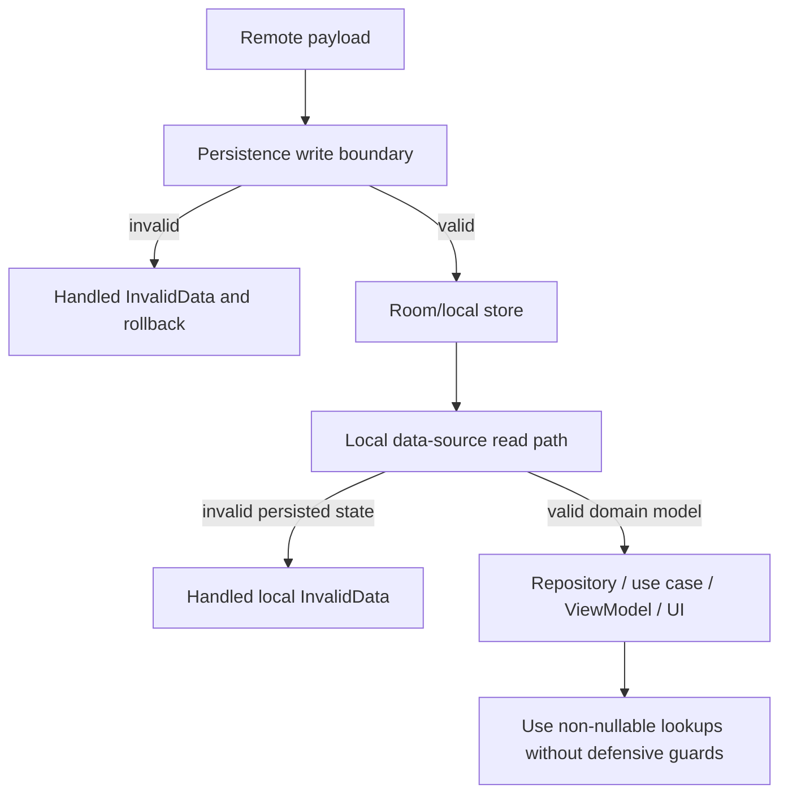

# Architecture Rule 4: Backend-contract invariants — enforce at the persistence boundary, trust downstream

## Status
Accepted

## Context
The backend guarantees certain structural invariants on the payloads it returns — for example, every chat participant list contains exactly one participant with `isCurrentUser=true`. Downstream code (use cases, ViewModels, UI) depends on these invariants and reads cleaner when it can assume they hold: `participants.first { it.isCurrentUser }` instead of `firstOrNull` + null handling at every call site.

A malformed payload can still arrive (backend bug, partial rollout, corrupted response). Persisted data can also become invalid later (migration bug, local-store corruption, manual database modification, partial wipe/restore bug). Two questions must be answered consistently: **where** is the invariant checked, and **what happens** when it fails?

For backend payloads, three possible places can check the invariant:
1. Re-check the invariant defensively at every consumer that depends on it.
2. Validate when the remote response is deserialized, before it becomes a domain delta.
3. Validate at the persistence boundary, inside the database transaction that commits the payload.

This rule chooses option 3 as the authoritative write-time enforcement point.

For persisted data that later becomes invalid despite write-time validation, the equivalent placement question is whether to detect corruption centrally when database rows are read and mapped into a domain object, or defensively at every consumer. The same centralization rule applies: detect it in the local data-source read path before returning domain data.

## Applicability
This rule applies whenever a backend payload carries a structural invariant that must hold for the payload to be stored and exposed as valid local/domain data.

A structural invariant is a rule about the payload's shape, required number of items, or relationships between records. Examples include exactly one current-user participant per chat, no duplicate participant links within a chat, or a message referencing an existing chat. This is different from ordinary field validation or operation-specific business rules that a use case intentionally evaluates.

## Rule
**Each backend-contract invariant that protects persisted data has one authoritative write-time enforcement site: the persistence boundary, inside the write transaction. A violating payload is rejected as a handled data-source error and the transaction is rolled back, so invalid data never reaches the local store through write paths that follow this rule. If persisted data later violates the invariant, detect it in the local data-source read path before returning domain data and return a handled local data-integrity error. Downstream consumers trust returned domain data and must not add defensive guards.**

## Related records
- [AR-02: Error hierarchy openness](AR-02-error-hierarchy-openness.md) governs how boundary-detected invariant failures are represented: because these failures affect control flow, they should be explicit closed error variants rather than catch-all or display-only errors.

## Rationale
- The persistence boundary is where untrusted backend data becomes the local source of truth. Checking the invariant inside the commit transaction makes this the authoritative validation for the rows being persisted. Earlier remote deserialization may fail fast on invalid payloads, but it validates an earlier representation rather than the data being committed to the local source of truth, and it is not coupled to database rollback, so it does not replace the transactional check that protects the local store.
- Write-time validation does not guarantee the local store can never become invalid later. Migrations, corruption, manual database changes, restore bugs, or bypassed write paths can still produce invalid rows. The local data-source read path is therefore the chokepoint for mapping corrupted rows into handled data-source errors before they become domain objects.
- Read-time validation is not a substitute for rejecting invalid backend data before commit. Write-time rejection keeps the local source of truth valid on writes; read-time validation ensures consumers only receive data that satisfies the invariant.
- Performing the check inside the write transaction couples rejection to rollback: a violation aborts the whole delta atomically and never leaves a half-applied record. This is why the check throws and is mapped at the method boundary rather than returning an error inline; the throw triggers transaction rollback.
- A violating backend payload is a handled data-source error, not a crash: the validation failure thrown inside the transaction rolls back the write, then the data-source method catches it and returns the corresponding error variant. The caller decides how to surface the failure.
- Consumer-level guards remain the wrong place to handle invariant failures. They scatter error handling, can drift from the backend contract, and hide data-integrity failures from the local data source read boundary that can handle them consistently in one place. Consumers should operate on already-validated domain data.

## Implications
- Each backend-contract invariant has one authoritative write-time enforcement site at the persistence boundary, not scattered across consumers.
- Local data-source read paths validate persisted data before exposing it as domain data when invalid rows would violate the invariant.
- Data-source error hierarchies carry explicit variants for rejected payloads or corrupted persisted data (e.g. `LocalDataSourceError.InvalidData`) so violations are surfaced, not swallowed.
- Consumers that look up data guaranteed by the contract use non-nullable lookups (`first {}`, `single {}`), not their `…OrNull` defensive counterparts.
- Adding a write path that can affect invariant-protected local data means routing it through the same authoritative validation, or the downstream trust guarantee is silently broken.

## Enforcement
- Write-time validation of a backend-contract invariant lives in the data-source write path and runs inside the database transaction against the local write set or resulting rows before commit.
- Read-time validation for corrupted persisted data lives in the local data-source read path, before returning domain data to repositories or use cases.
- A violation is converted to a handled data-source error at the public method boundary; it does not propagate as an exception to callers.
- Each invariant has persistence-boundary tests covering valid payloads, invalid payloads, and rollback/no-partial-write behavior.
- Each read-time integrity check has tests covering corrupted persisted rows being returned as handled errors rather than consumer crashes.
- When practical, database constraints or indexes are added as defense in depth. They complement boundary validation; they do not replace it when the full invariant cannot be expressed by the schema.
- CI/static analysis should flag defensive consumer anti-patterns for contract-guaranteed lookups where false positives can be kept low; code review rejects remaining defensive `firstOrNull` / null-handling guards.
- Code review rejects treating remote-response validation as the only enforcement before persistence when local data can still be written without the boundary check.

## Example: the current-user participant contract
- **Invariant:** every chat participant list contains exactly one participant with `isCurrentUser=true`; zero or multiple is an invalid payload.
- **Write-time enforcement:** the sync local data source validates the participant set inside the database transaction before committing affected chat/participant rows. On violation, validation throws an internal exception so the transaction rolls back; the public data-source method catches it and returns `LocalDataSourceError.InvalidData`.
- **Read-time integrity check:** the chat local data source checks persisted participant rows before mapping them to a domain `Chat`. If persisted data has zero or multiple current-user participants, it returns `LocalDataSourceError.InvalidData` instead of exposing invalid domain data.
- **Consumer trust:** consumers such as `ChatViewModel` use non-nullable lookups for contract-guaranteed participants because write-time and read-time validation prevent invalid participant sets from being exposed as domain data.

## Anti-patterns
- `participants.firstOrNull { it.isCurrentUser }` + null handling in a consumer — re-guards an invariant already guaranteed for successfully returned domain data, scattering error handling and masking data-integrity bugs.
- Returning a `ResultWithError.Failure` from in-transaction validation instead of throwing — does not trigger transaction rollback and can leave a partially applied delta committed.
- Treating remote-response validation as the only enforcement before persistence — early remote validation is allowed, but it does not replace the persistence-boundary check that validates committed data and couples failure to rollback.
- Swallowing a contract violation by logging and continuing instead of rejecting the payload — lets invalid data into the source of truth.
